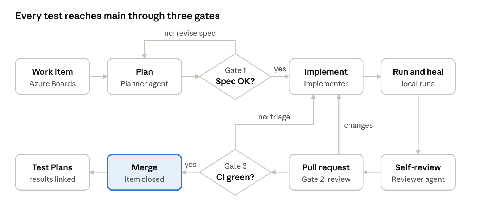
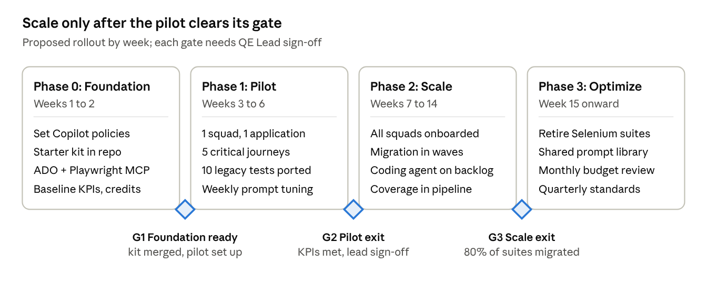

# QE Engineering Playbook: VS Code + GitHub Copilot

Last updated: 2026-10-13

## 1. Purpose and scope

This playbook sets one way of working for QE engineers who build Playwright TypeScript automation with GitHub Copilot in VS Code. It also covers migrating the existing Selenium Java and Python suites. Every rule here works inside the constraints below.

| Constraint | What it means for how we work |
| --- | --- |
| Copilot Business, $500 AI credits per engineer per month, reset monthly | Budget is managed per person. Premium-model use is matched to the task (section 7). |
| No external model or API access | Copilot is the only AI. No direct LLM calls, no BYOK, no remote MCP servers. Only local or internal MCP servers (Playwright, Azure DevOps). |
| Azure Repos, Azure Pipelines, Azure Boards and Test Plans | Copilot customization files live in the repo. Azure DevOps is the source of truth for requirements, test cases and results. |
| Target stack is Playwright TypeScript; legacy is Selenium Java and Python | Migration is its own workstream with its own prompts and gates (section 6). |
| No data classification rules | Governance stays light. Synthetic test data is still the default because it keeps tests deterministic. |

**In scope:** UI automation, API testing, coverage analysis and test data generation (primary focus). Performance, accessibility, mobile and security testing follow the same workflow, with their own instruction files added later.

**Audience:** QE Engineers, who use this every day, and QE Leads, who own standards, reviews, gates and budget.

**Companion starter kit:** a ready-to-copy repo skeleton with Copilot instructions, prompt files, custom agents, MCP config, a Playwright framework and an Azure pipeline (section 12).

## 2. Operating model

Each Copilot capability has one job in the QE workflow. Pick the cheapest capability that can do the task well.

| Capability | Use it for | Credit use | Primary user |
| --- | --- | --- | --- |
| Inline completions and next edit suggestions | Locators, assertions, fixtures, boilerplate while typing | Included | Engineer |
| Ask and Plan in Chat | Explaining legacy code, test design, planning before edits | Base model included; premium if selected | Engineer |
| Agent mode | Multi-file implementation: page objects, specs, data factories, running and fixing tests in the terminal | Premium per request | Engineer |
| Custom agents (`.agent.md`) | Role-scoped work: QE Planner (read-only), QE Implementer (edit + terminal), QE Reviewer (read-only), with handoffs between them | Depends on the model each agent pins | Engineer, defined by Lead |
| Prompt files (`/commands`) | Repeatable tasks: test plan from work item, page object, API tests, migration, flaky triage, coverage gaps | Depends on the model each prompt pins | Engineer, defined by Lead |
| Copilot coding agent | Async work on well-specified Azure Boards items; it opens a PR for review | Premium per session | Lead assigns, engineer reviews |
| Copilot code review | First-pass review on PRs before human review | Premium per review | Reviewer |
| MCP: Playwright | Agent drives a local browser to explore the app and confirm locators | Local; no extra cost | Engineer |
| MCP: Azure DevOps | Agent reads work items, acceptance criteria, test cases and pipeline runs | Internal; no extra cost | Engineer, Planner agent |
| Playwright Test Agents (planner, generator, healer) | Optional. Generated by `npx playwright init-agents --loop=vscode` (Playwright 1.56+). Evaluate in the pilot. | Uses Copilot models | Engineer |

**Roles**

- **QE Lead** owns the customization files, approves test specs (Gate 1), reviews framework changes, tracks team credit usage and KPIs, and assigns coding-agent work.
- **QE Engineer** turns work items into specs and tests through the agent workflow. They own every line of code they merge, whether AI wrote it or not.
- **Copilot admin** (platform team) manages model enablement, policies, content exclusion, the MCP allow-list and billing alerts.
- **Dev teams** add stable `data-testid` attributes and keep OpenAPI specs current. Both make AI-generated tests far more reliable.

## 3. Repository setup and Copilot customization

All AI behaviour is defined by files in the repo, so every engineer gets the same standards and results. These files are treated as code: changes go through a PR approved by a QE Lead.

```text
.github/
  copilot-instructions.md            # repo-wide standards, always applied
  instructions/
    playwright-ui.instructions.md    # applyTo: tests/ui/**, src/pages/**
    api-tests.instructions.md        # applyTo: tests/api/**, src/api/**
    test-data.instructions.md        # applyTo: src/data/**
    migration.instructions.md        # applyTo: legacy/**, tests/**
  prompts/                           # invoked as /name in Chat
    test-plan-from-work-item.prompt.md
    generate-page-object.prompt.md
    generate-api-tests.prompt.md
    generate-test-data-factory.prompt.md
    migrate-selenium-test.prompt.md
    triage-flaky-test.prompt.md
    coverage-gap-analysis.prompt.md
  agents/                            # picked from the agent dropdown
    qe-planner.agent.md
    qe-implementer.agent.md
    qe-reviewer.agent.md
.vscode/
  mcp.json                           # Playwright + Azure DevOps MCP servers
  settings.json                      # Copilot and terminal guardrails
  extensions.json
.azuredevops/pull_request_template.md
AGENTS.md                            # shared guidance for all agents, incl. coding agent
docs/specs/                          # approved test specs, one per feature
src/  pages/  api/  data/  fixtures/
tests/  ui/  api/
scripts/api-coverage.ts
azure-pipelines.yml
```

| File | What it controls | When it applies | Owner |
| --- | --- | --- | --- |
| `copilot-instructions.md` | Stack, folder layout, naming, coding rules, what never to do | Every chat request in the repo | QE Lead |
| `*.instructions.md` | Detailed rules for one area (UI, API, data, migration) | Automatically, when files matching `applyTo` are in context | QE Lead |
| `*.prompt.md` | One repeatable task: inputs, steps, output format, pinned model and tools | When an engineer types `/name` | QE Lead, engineers propose |
| `*.agent.md` | A persona with allowed tools, pinned model and handoff buttons to the next agent | When chosen in the agent picker | QE Lead |
| `AGENTS.md` | Build, run and test commands plus definition of done | Agent mode and the coding agent | QE Lead |
| `.vscode/mcp.json` | Which MCP servers agents can use | When an agent calls a tool | Copilot admin + QE Lead |

**Rules for writing these files**

- Keep `copilot-instructions.md` under about two pages. It is sent with every request, so extra length costs context and dilutes the rules.
- Write rules as short imperatives with one example each ("Use `getByRole` first. Example: …"). Avoid essays.
- Put area-specific detail in `*.instructions.md` files scoped by `applyTo`, not in the repo-wide file.
- Each prompt file states its inputs, numbered steps, output format and a definition of done.
- Pin a `model` in prompts and agents to control cost. Use the base model by default and premium only where the task needs reasoning.
- Review the files every sprint. When Copilot repeats a mistake, add a rule; when a rule is never needed, delete it.

## 4. Orchestrated workflow

Every automated test follows one path from an Azure Boards work item to a merged PR, with three gates where a person or the pipeline decides.



A rejected spec goes back to planning. Requested PR changes or a red pipeline go back to implementation.

1. **Pick up the work item.** The engineer opens the story in Azure Boards and confirms it has acceptance criteria.
2. **Plan (QE Planner agent, read-only).** Run `/test-plan-from-work-item <id>`. The planner reads the story through the Azure DevOps MCP server and drafts `docs/specs/<feature>.md`: scenarios, priority, test level (UI or API), data needs and risks.
3. **Gate 1: spec approval.** A QE Lead reviews the spec in a short PR or comment. Nothing is implemented from an unapproved spec. This is the biggest saving in credits and rework.
4. **Implement (QE Implementer agent).** Use the handoff button from the planner. The implementer creates page objects, API clients, data factories and specs that follow the instruction files. A small, fully specified item can go to the Copilot coding agent instead.
5. **Run and heal locally.** The implementer runs `npx playwright test <spec> --repeat-each=3` in the terminal and fixes failures. Stop after three failed fix attempts and step in yourself.
6. **Self-review (QE Reviewer agent, read-only).** Checks the diff against the standards and the spec, then lists findings. The engineer fixes them before opening the PR.
7. **Gate 2: pull request.** Copilot code review gives a first pass, then a human reviewer approves. Branch policies require a linked work item and a passing build.
8. **Gate 3: pipeline.** Lint, typecheck and the affected tests must pass, with no new flaky tests.
9. **Merge and publish.** Results flow to Azure Test Plans through test case ID tags, which gives requirement traceability.

**Why separate agents:** each agent only has the tools its job needs. The planner and reviewer cannot edit files, so planning and review stay independent of implementation. Handoffs pass context forward without a new prompt.

## 5. Practice playbooks

Each practice has fixed standards, which are encoded in its instruction file, and a default Copilot route.

### 5.1 UI automation

- **Locators:** `getByRole` first, then `getByLabel` and `getByText`, then `getByTestId`. Use CSS or XPath only with a code comment explaining why. Agree a `data-testid` convention with dev teams.
- **Page Object Model:** one class per page or reusable component. Methods describe user intent (`login(user)`), not clicks. Assertions live in specs, not page objects.
- **Waiting:** web-first assertions (`await expect(locator).toBeVisible()`) only. No `waitForTimeout`, no hand-written sleeps.
- **Setup:** custom fixtures in `src/fixtures`. Authentication runs once in a setup project and is reused through `storageState`.
- **Tags:** every test has a suite tag (`@smoke`, `@regression`) and its Azure Test Plans case ID (`@TC12345`).
- **Copilot route:** the Playwright MCP explores the page → `/generate-page-object` → the Implementer writes the spec → `--repeat-each=3` locally before the PR.

### 5.2 API testing

- Use Playwright's `request` fixture with one typed client per service in `src/api`. Base URLs and tokens come from environment variables.
- For each endpoint, cover the success path, validation errors, auth failures (401/403), not-found, boundary values and idempotency where it applies.
- Validate response bodies against the OpenAPI schema, not just status codes.
- Keep the OpenAPI spec in the repo (or pull it in the pipeline) so Copilot can read it with `#file`.
- **Copilot route:** `/generate-api-tests` with the OpenAPI file and endpoint name → the Implementer runs the tests against the dev environment.

### 5.3 Coverage analysis

Measure coverage through three lenses. Copilot summarizes gaps and proposes tests; QE Leads prioritize by risk. Do not chase 100%.

| Lens | Question it answers | How | Tooling |
| --- | --- | --- | --- |
| Requirement | Does every acceptance criterion have a passing test? | Test case ID tags; results published to Test Plans; `/coverage-gap-analysis` compares story criteria with specs | Azure Test Plans, Azure DevOps MCP |
| API endpoint | Which operations, methods and status codes are never exercised? | Compare OpenAPI operations with requests recorded during the run | `scripts/api-coverage.ts` (starter kit) |
| Application code | Which front-end code do UI tests exercise? | Instrumented app build (Istanbul) or Chromium V8 coverage, published as Cobertura | `monocart-reporter` or `nyc`; `PublishCodeCoverageResults@2` |

### 5.4 Test data generation

- Build data with factories in `src/data/factories`, using `@faker-js/faker` with a fixed seed so failures can be reproduced.
- Create data through APIs inside fixtures and delete it in teardown. Make values unique per test (worker index or UUID) so parallel runs never collide.
- Ask Copilot for boundary and negative data sets generated from the schema, then drive them as data-driven tests.
- Keep production data out of tests even without classification rules, because synthetic data keeps tests deterministic and portable.
- **Copilot route:** `/generate-test-data-factory` with the TypeScript type or OpenAPI schema attached.

## 6. Selenium to Playwright migration

Rebuild each test around what it is meant to check; do not translate it line by line. A literal port carries over the sleeps, brittle XPath and driver workarounds that Playwright makes unnecessary.

1. **Inventory and triage.** List every legacy test with its run history (pass rate, flakiness, last failure). Use Copilot Ask mode to summarize what each file checks. Mark each test keep, merge or retire. Retiring duplicates and dead tests is the cheapest migration.
2. **Port the shared layer first.** Page objects, utilities and data builders move to TypeScript before any specs, so migrated specs have a stable base.
3. **Migrate in waves by business journey.** Order waves by value and pain: critical journeys and the flakiest suites go first.
4. **Run old and new side by side.** Both suites run in the pipeline for two sprints per wave. Compare results, then disable the legacy tests for that wave.
5. **Decommission.** Delete retired legacy code and remove the Java and Python jobs from the pipeline.

| Selenium (Java / Python) | Playwright TypeScript |
| --- | --- |
| `WebDriverWait`, `Thread.sleep`, `time.sleep` | Auto-waiting actions and web-first `expect` assertions |
| `By.xpath`, `By.cssSelector` | `getByRole`, `getByLabel`, `getByTestId` |
| TestNG / JUnit hooks, pytest fixtures | Playwright fixtures (`test.extend`) |
| `@DataProvider`, `@pytest.mark.parametrize` | A loop over a typed data array that generates `test()` cases |
| AssertJ, Hamcrest, `assert` | `expect` with soft assertions where useful |
| Selenium Grid | Playwright workers plus pipeline sharding (`--shard=1/4`) |
| WebDriverManager, chromedriver | Bundled browsers (`npx playwright install`) |
| Screenshot listeners | `trace: 'on-first-retry'`, `screenshot: 'only-on-failure'` |
| Login through the UI in every test | A setup project that saves `storageState` once |

**Copilot route:** attach the legacy file and run `/migrate-selenium-test`. The prompt states the intent of the legacy test first, reuses existing page objects, flags anything it could not map, and lists retired assertions with reasons. Simple tests use the base model; tests built on custom legacy frameworks justify a premium model.

## 7. Model selection and AI credit budget

At $500 per engineer per month, running out of credits is not the main risk. The real risks are spending them on low-value prompts and getting inconsistent output from ad-hoc model choices.

**How large the budget is.** Copilot Business includes a monthly allowance of premium requests per user (300 at the time of writing). If your $500 is billed at the premium-request rate ($0.04 each), it adds about 12,500 requests per engineer per month for a model with a 1x multiplier. Models with higher multipliers use proportionally more. Confirm with the Copilot admin how "AI credits" are metered in your contract.

| Tier | Use for | Where it is set |
| --- | --- | --- |
| Included (base model, 0x) | Completions, explanations, small edits, docs, commit messages, simple migrations, triage summaries | Default for Ask mode and most prompt files |
| Standard premium (about 1x) | Agent-mode implementation, page objects, API suites, typical migrations, self-review | Pinned in the Implementer and Reviewer agents |
| High-reasoning premium (above 1x) | Framework architecture, migrating custom legacy frameworks, root-causing stubborn flaky tests, cross-cutting refactors | Selected by hand for that one task only |

The Copilot admin publishes the approved model for each tier in the team wiki and updates it when GitHub changes the model list. Agents and prompts pin models through their `model` field.

**Suggested monthly split per engineer (soft guide):** 60% feature automation, 20% migration, 10% maintenance and triage, 10% reserve.

**Tracking:** set premium-request budgets and alerts at 50%, 75% and 90% in GitHub billing (or in Azure, if GitHub billing is linked to your Azure subscription). QE Leads review usage per engineer every month alongside the KPIs in section 10.

**Habits that save credits**

- One task per chat. Start a new chat when the task changes, so old context is not resent.
- Attach the exact files with `#file` rather than relying on whole-workspace search.
- Plan with the base model, then run agent mode once against an approved spec.
- Use prompt files instead of retyping long instructions.
- Stop an agent loop after three failed fix attempts and diagnose it yourself.
- Give the coding agent only items with clear acceptance criteria and an approved spec.

## 8. Azure DevOps integration

Azure DevOps stays the system of record. Copilot reads from it through the Azure DevOps MCP server and writes back only through PRs and pipeline results.

| Service | Role in QE | How it connects to Copilot and Playwright |
| --- | --- | --- |
| Azure Boards | Stories, acceptance criteria, bugs | The Planner agent reads work items through the Azure DevOps MCP server. Well-specified items can be assigned to the Copilot coding agent. |
| Azure Repos | Code, PRs, branch policies | Policies: at least one reviewer, QE Lead auto-added for `.github/**` and `src/fixtures/**`, linked work item required, build validation required. Copilot code review gives the first-pass review. |
| Azure Pipelines | CI | PR validation runs lint, typecheck and `@smoke`. Nightly runs full regression sharded across agents. Publishes JUnit results, HTML report, traces and Cobertura coverage. |
| Azure Test Plans | Test cases and results | Tests carry `@TC<id>` tags. Results are linked to test cases through a Playwright Azure reporter or the Test Plans REST API. |
| Azure Artifacts | Package feed | Upstream source for npm packages, so installs work without direct public internet access. |

**Restricted-network notes**

- Playwright downloads browsers from its CDN. Mirror them internally and set `PLAYWRIGHT_DOWNLOAD_HOST`, or run in the official Playwright container image pulled from your internal registry.
- Run MCP servers from the internal npm feed with pinned versions. The Azure DevOps MCP server signs in with your Microsoft Entra account in the browser, so no tokens are stored in files.
- Confirm with the Copilot admin which coding-agent and code-review features are live for Azure Repos in your tenant. Where one is not available, the Reviewer agent in VS Code covers the same step locally.

## 9. Governance, security and quality gates

The engineer who merges AI-generated code owns it, and nothing reaches main without a human approval and a green pipeline.

| Gate | When | Pass criteria | Owner |
| --- | --- | --- | --- |
| Gate 1: Spec | Before implementation | Every acceptance criterion mapped to a scenario; test level, data needs and priority stated | QE Lead |
| Gate 2: Pull request | Before merge | Copilot review comments resolved; human approval; lint and typecheck clean; `--repeat-each=3` passed locally; PR checklist complete | Reviewer |
| Gate 3: Pipeline | On every PR and nightly | All affected tests pass; no new flaky tests; coverage does not drop | Automated |

**Guardrails**

- **Customization files are code.** Changes to `.github/**`, `AGENTS.md` and `.vscode/mcp.json` need QE Lead approval through an Azure Repos path policy.
- **PR template** records whether the change was AI-assisted, which agent or prompt was used, and confirms there are no hard waits, missing tags or secrets.
- **Admin policies:** approved models only, the public-code-matching filter on, and content exclusion for secret-bearing paths such as `.env*`.
- **MCP allow-list:** only the Playwright and Azure DevOps MCP servers, pinned versions, local execution. No remote MCP servers.
- **Terminal approvals:** agents may auto-run only allow-listed commands (`npx playwright test`, `npm run lint`, `npm run typecheck`). Everything else needs the engineer's confirmation.
- **Secrets** live in Azure Key Vault or pipeline secret variables, never in code or prompts. Turn on secret scanning if your organization licenses it.
- **Audit:** review Copilot usage metrics and the audit log every month.

## 10. Metrics and KPIs

Take a baseline in Phase 0, then review monthly. The targets below are proposals for QE Leads to confirm.

| Metric | Definition | Proposed target | Source |
| --- | --- | --- | --- |
| Automation lead time | Story ready to tests merged | 30% faster than baseline by pilot exit | Azure Boards |
| Migration progress | Share of legacy tests ported or retired | On plan for each wave | Migration inventory |
| Flaky rate | Tests that fail then pass on retry, last 30 days | Below 2% | Pipeline analytics |
| Requirement coverage | Acceptance criteria with a linked passing test | 90% or more for new stories | Azure Test Plans |
| API endpoint coverage | OpenAPI operations with at least one test | 80% or more | `scripts/api-coverage.ts` |
| Escaped defects | Production bugs with no covering test | Falling quarter on quarter | Azure Boards bugs |
| Credits per merged test | Premium spend divided by tests merged | Falling month on month | Billing + repo |
| Suggestion acceptance | Share of Copilot suggestions accepted | Tracked, no target | Copilot usage metrics |

## 11. Rollout plan

Roll out in four phases over about 14 weeks. One squad proves the workflow before every squad adopts it.



Week numbers count from kickoff. Each gate is a go or no-go review chaired by the QE Leads, and the next phase starts only after it passes.

**RACI** (R = responsible, A = accountable, C = consulted, I = informed)

| Activity | QE Lead | QE Engineer | Copilot admin | Dev team |
| --- | --- | --- | --- | --- |
| Copilot policies, models, MCP allow-list | C | I | A/R | I |
| Customization files and starter kit | A/R | C | C | I |
| Test specs from work items | A | R | I | C |
| Spec approval (Gate 1) | A/R | I | I | C |
| Test implementation | A | R | I | C |
| PR review (Gate 2) | A | R | I | C |
| `data-testid` and OpenAPI upkeep | C | C | I | A/R |
| Migration wave planning | A/R | C | I | C |
| Credit usage and KPI review | A/R | I | C | I |

## 12. Starter kit and prompting guide

The starter kit (the rest of this repository) puts sections 3 to 9 into practice. Copy it into a new Azure Repos repo, point npm at your Azure Artifacts feed, run `npm ci`, and open it in VS Code.

| Area | Files | Purpose |
| --- | --- | --- |
| Copilot context | `.github/copilot-instructions.md`, `.github/instructions/*.instructions.md`, `AGENTS.md` | Standards for UI, API, data and migration |
| Workflows | `.github/prompts/*.prompt.md` (7 prompts) | Test plan, page object, API tests, data factory, migration, flaky triage, coverage gaps |
| Agents | `.github/agents/qe-planner`, `qe-implementer`, `qe-reviewer` | Role-scoped personas with handoffs |
| VS Code | `.vscode/mcp.json`, `settings.json`, `extensions.json` | MCP servers, terminal allow-list, recommended extensions |
| Framework | `playwright.config.ts`, `src/fixtures`, `src/pages`, `src/api`, `src/data` | Fixtures, sample page object, API client, seeded data factory |
| Examples | `tests/ui/login.spec.ts`, `tests/api/users.api.spec.ts`, `docs/specs/_TEMPLATE.md` | Reference tests and the spec template |
| CI and coverage | `azure-pipelines.yml`, `scripts/api-coverage.ts`, `.azuredevops/pull_request_template.md` | PR and nightly pipeline, endpoint coverage report, PR checklist |

**Prompting do's**

- Name the goal, the inputs (`#file`, work item ID) and the expected output format in the first message.
- Point to an existing example: "follow the pattern in `LoginPage.ts`".
- Ask for a plan first on anything touching more than three files.
- Ask Copilot to list its assumptions and the things it could not verify.
- Review every diff as if a new teammate wrote it.

**Prompting don'ts**

- Don't ask for a whole framework or suite in one prompt.
- Don't paste secrets, tokens or real customer data.
- Don't accept generated locators without running them against the real page.
- Don't let an agent loop more than three times on the same failure.
- Don't fix a recurring Copilot mistake in chat; add a rule to the instruction files.
